# 5. Functional Decomposition

Sơ đồ phân rã dưới đây là phân loại hệ thống theo 8 nhóm nghiệp vụ đã có trong mô hình dữ liệu. Trạng thái mỗi nhóm được ghi rõ; nhánh có database không hàm ý đã có chức năng API/UI.

```mermaid
flowchart TD
    WMS[Commercial WMS]
    WMS --> P[1. Product Catalog]
    WMS --> SM[2. Suppliers and Manufacturers]
    WMS --> WL[3. Warehouses and Locations]
    WMS --> CE[4. Customers and Employees]
    WMS --> PR[5. Purchasing, Receiving and Quality]
    WMS --> IT[6. Inventory, Lots, Transfers and Adjustments]
    WMS --> SD[7. Sales, Deliveries, Returns and Payments]
    WMS --> SS[8. Stock Count and System]

    P --> P1[Categories / Brands / Products - API + UI]
    P --> P2[Units / storage requirements / warehouse policies - schema only]
    SM --> SM1[Suppliers / contacts / supplier products - API + UI]
    SM --> SM2[Manufacturers / documents - schema and data only]
    WL --> WL1[Warehouses / zones / aisles / racks / shelves / bins - schema and data only]
    CE --> CE1[Customers / addresses / employees - schema and data only]
    PR --> PR1[Purchase orders / receipts / inspection - schema and data only]
    IT --> IT1[Lots / balances / transactions - schema and demo data only]
    IT --> IT2[Transfers / adjustments / reservations - schema and demo data only]
    SD --> SD1[Sales / delivery / return / payment - schema and demo data only]
    SS --> SS1[Stock counts / settings / audit / temperature - schema and data only]
```

Mã nguồn diagram UML dùng cho Y1 của PMA cần được đối chiếu mẫu Visio trước khi chuyển giao; mẫu `.vsd` chưa đọc được đầy đủ nên sơ đồ này không được tuyên bố là bản sao đúng định dạng giảng viên.

## Nhánh tương lai — chưa được phê duyệt

Có thể xem xét API/UI cho nhận hàng, kiểm định, tồn kho, bán hàng, giao nhận, thanh toán, trả hàng, kiểm kê và báo cáo sau khi xác định actor, workflow, quyền, acceptance criteria và chủ sở hữu dữ liệu. Đây chỉ là đề xuất, không phải kế hoạch Sprint.
